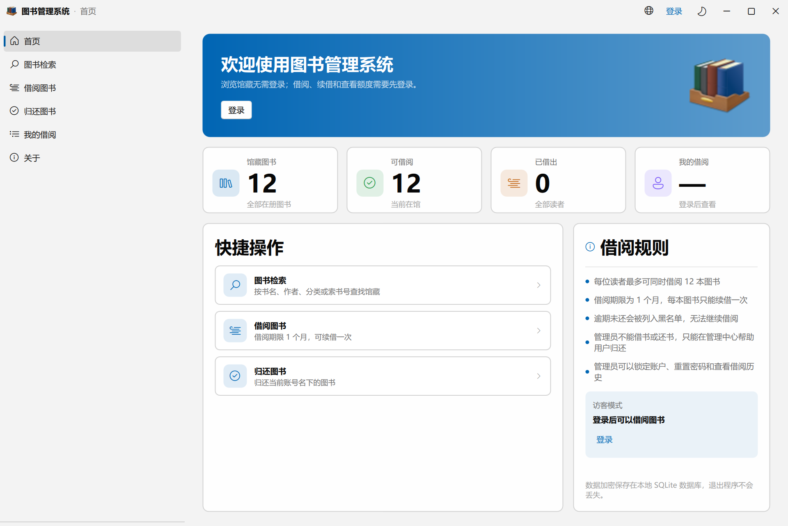

# 图书管理系统 · Qt QML + FluentUI 重构版

> 将 Vision 1.0 的 CMD + MSVC 图书管理程序重构为 **Qt 6 QML + CMake + FluentUI** 桌面应用。

[](https://www.qt.io/)
[](https://cmake.org/)
[](https://github.com/zhuzhihang/FluentUI)
[](https://www.microsoft.com/windows)

---

## 项目简介

本项目最初是一个基于命令行的 C++ 图书管理作业（Vision 1.0，MSVC + `.sln`）。重构版保留图书、账户、借阅、检索和管理员能力，将界面迁移到 Fluent Design 风格的 Qt QML 桌面程序，并使用 CMake 管理构建。

- **界面**：Qt 6 QML + [FluentUI 1.7.7](https://github.com/zhuzhihang/FluentUI)，自定义标题栏、响应式导航、深色 / 浅色主题。
- **业务**：C++17 `LibraryService` 单例，向 QML 暴露账户、图书、借阅、额度、统计和管理接口。
- **存储**：Qt SQL（SQLite）数据库；用户、图书和借阅字段逐字段 **AES-256-GCM** 加密，主密钥由 **Windows DPAPI** 保护。
- **密码**：只保存 **PBKDF2-HMAC-SHA256** 哈希，管理员不能查看原始密码，只能重置。
- **迁移**：首次运行时可自动读取旧版 `book.control`、`user.control`、`pass.control` 等文件并加密导入 SQLite。

> 重构后已移除原 MSVC 工程（`.sln` / `.vcxproj` / `.rc` / `Main.cpp` / `x64` 等）与旧版 `control` 数据文件。

---

## 界面预览

### 登录（仅在借阅等操作时弹出）


### 首页 · 访客模式



### 图书检索


### 管理中心 · 加密数据库


### 深色主题


---

## 功能

| 模块 | 功能 |
| --- | --- |
| 访客模式 | 启动直接进入首页，可浏览馆藏、搜索图书、查看可借状态；借阅、续借、归还和额度需要登录 |
| 登录 | 用户名 / 密码登录；管理员与读者权限区分；密码连续输错 5 次临时锁定 10 分钟；管理员也可手动锁定 |
| 首页 | 馆藏 / 可借 / 借出 / 我的额度统计、快捷入口、借阅规则、黑名单提醒 |
| 图书检索 | 按全部、书名、作者、索书号、分类搜索；结果直接借阅 / 归还；显示封面、分类、简介、位置和应还日期 |
| 借阅 | 输入索书号或列表一键借阅；借阅期限 **1 个月**；每人最多 **12 本**；每本书同一时间仅一位借阅人 |
| 续借 | 每本图书可续借 **1 次**，到期后 1 个月；逾期后不允许续借 |
| 归还 | 输入索书号或列表一键归还；归还后额度立即恢复 |
| 黑名单 | 逾期未还或被管理员标记未还的读者进入黑名单，归还全部逾期图书前不能继续借阅 |
| 我的借阅 | 借阅额度进度、在借清单、借阅日期、应还日期、续借状态和黑名单状态 |
| 管理中心 · 图书 | 录入图书（可选封面、简介、分类）、查看全部馆藏、查看借阅历史、帮助用户归还、标记未还 |
| 管理中心 · 用户 | 创建读者账户、锁定 / 解锁、重置密码、删除账户；**不显示密码**；管理员和当前账户不能锁定 / 删除 |
| 管理中心 · 数据 | 数据库路径、复制路径、打开所在文件夹、统计信息、载入 12 本示例图书、旧版数据迁移提示 |
| 个人资料 | 修改账号名称、显示名称、选择 / 清除头像、修改密码、退出登录 |
| 多语言 | 简体中文、繁體中文、English、日本語、Deutsch、Русский、한국어；标题栏语言按钮即时切换 |
| 主题 | 标题栏深色 / 浅色切换；导航栏不再重复放主题按钮 |
| 快捷键 | `Ctrl+1` 首页、`Ctrl+2` 检索、`Ctrl+3` 借阅、`Ctrl+4` 归还、`Ctrl+5` 我的借阅、`Ctrl+6` 管理中心（管理员）、`Ctrl+7` 关于、`Ctrl+L` 语言、`Ctrl+P` 个人资料 |

### 账户与借阅规则

- 管理员默认账号：

```text
用户名：Administrator
密码：114514
```

- 管理员首次登录会自动填入默认账号，并**强制修改密码**，完成前不能使用系统。
- 密码要求：至少 8 位，同时包含大写字母、小写字母、数字和特殊符号。
- 新读者账户首次登录也必须修改密码。
- 管理员不能借书、还书或续借；只能在管理中心查看借阅历史、帮助用户归还或标记未还。
- 借阅期限 1 个月；每本可续借一次；逾期未还会进入黑名单。

---

## 数据与加密

### 存储位置

默认位置（按当前 Windows 用户）：

```text
%APPDATA%\BuBaiMengJ4\LibraryManagementSystem\
├── library.db    # SQLite 数据库
├── library.key   # DPAPI 保护的主密钥
└── logs\app.log  # 运行日志
```

如果该目录不可写，程序会依次回退到可执行文件旁的 `data/`、系统临时目录，并在日志中记录实际路径。管理中心的“数据与示例”页会显示当前数据库路径。

### 加密方案

- 使用 **Qt SQL / QSQLITE** 驱动，数据库为单文件 SQLite。
- 每个用户字段（用户名、显示名称、管理员标记、锁定状态、头像等）、每个图书字段（书名、作者、出版社、位置、分类、简介、封面等）和每条借阅字段都单独使用 **AES-256-GCM** 加密。
- 密文格式：`0x01 | 12 字节 nonce | 16 字节认证标签 | 密文`。
- AAD 绑定 `library/user/<uuid>/<字段>`、`library/book/<索书号>/<字段>` 或 `library/loan/<id>/<字段>`，避免密文被跨字段替换。
- 32 字节主密钥由 `QRandomGenerator` 生成，写入前通过 **Windows DPAPI**（当前用户范围）加密，保存为 `library.key`。
- 密码使用 **PBKDF2-HMAC-SHA256**（100000 次迭代、16 字节随机盐、32 字节哈希）保存，不可逆；管理员无法查看原始密码。
- 图书索书号、用户 UUID、借阅 ID 作为查询 / 关联键保留明文，不含个人文本内容。

### 数据库结构（schema v2）

```sql
users(id TEXT PRIMARY KEY, username_enc BLOB, display_name_enc BLOB,
      password_hash_enc BLOB, password_salt_enc BLOB, admin_enc BLOB,
      must_change_enc BLOB, locked_enc BLOB, failed_attempts_enc BLOB,
      lock_until_enc BLOB, avatar_enc BLOB)

books(number INTEGER PRIMARY KEY, name_enc BLOB, author_enc BLOB,
      publisher_enc BLOB, place_enc BLOB, category_enc BLOB,
      description_enc BLOB, cover_enc BLOB)

loans(id INTEGER PRIMARY KEY, book_number INTEGER, username_enc BLOB,
      borrowed_at_enc BLOB, due_at_enc BLOB, returned_at_enc BLOB,
      renew_count_enc BLOB, manual_unreturned_enc BLOB)
```

### 旧版数据迁移

首次启动且数据库中没有账户时，程序会尝试从以下目录读取 Vision 1.0 的 `control` 文件：

1. 可执行文件所在目录；
2. 可执行文件上两级目录（便于从项目根目录运行）；
3. 当前工作目录。

支持的旧文件：`book.control`、`name.control`、`writer.control`、`state.control`、`publisher.control`、`user.control`、`pass.control`、`user/*.control`。迁移完成后原始文件不会被修改；迁移结果会加密写入 SQLite，并在数据中心显示迁移提示。

### 备份与恢复

- 备份：关闭程序后复制 `library.db` 与 `library.key`。两者必须成对保存。
- 恢复：将同一对文件放回数据目录即可。
- `library.key` 由 DPAPI 绑定到“当前 Windows 用户 + 当前机器”，复制到其他用户或电脑后无法解密，这是预期的安全行为。
- 如果数据库存在但密钥丢失，程序会拒绝打开数据库并显示错误；需要恢复 `library.key` 或删除数据库重新开始。

---

## 构建

### 环境

- Windows 10 / 11 64 位
- Qt **6.11.1** MinGW 64-bit（项目自带 FluentUI 1.7.7 源码）
- CMake **3.21+**
- MinGW 13.1（随 Qt 安装：`C:\Qt\Tools\mingw1310_64`）
- Qt SQL SQLite 驱动（Qt 安装自带 `sqldrivers/qsqlite.dll`）

> 加密存储使用 Windows DPAPI + BCrypt，因此当前仅支持 Windows 构建。

### 命令行

```powershell
# 让 CMake 与 MinGW 可用
$env:Path = "C:\Qt\Tools\CMake_64\bin;C:\Qt\Tools\mingw1310_64\bin;C:\Qt\6.11.1\mingw_64\bin;" + $env:Path

# 配置
cmake -S . -B build -G "MinGW Makefiles" `
      -DCMAKE_BUILD_TYPE=Release `
      -DCMAKE_PREFIX_PATH="C:/Qt/6.11.1/mingw_64"

# 编译
cmake --build build --parallel 4
```

生成文件：

```text
build\bin\LibraryManagementSystem.exe
build\qml\FluentUI\fluentuiplugin.dll
```

运行时需要 Qt 的 DLL 与 SQLite 驱动在搜索路径中。推荐直接用 Qt Creator 打开根目录 `CMakeLists.txt` 并运行；或从 Qt 命令行启动：

```powershell
$env:Path = "C:\Qt\6.11.1\mingw_64\bin;" + $env:Path
.\build\bin\LibraryManagementSystem.exe
```

### 发布包

```powershell
cmake --build build --target deploy
```

该目标会生成 `build/dist`，其中包含 Qt 运行库、平台插件、`sqldrivers`、QML 模块和本项目构建的 FluentUI 插件：

```text
build\dist\LibraryManagementSystem.exe
build\dist\sqldrivers\qsqlite.dll
build\dist\qml\FluentUI\fluentuiplugin.dll
```

`build/dist/LibraryManagementSystem.exe` 可以脱离 Qt 安装目录直接运行（已在没有 Qt `PATH` 的环境下验证）。

### FluentUI 说明

项目以源码形式包含 [`FluentUI`](FluentUI)，根 `CMakeLists.txt` 将插件输出到：

```text
<build>/qml/FluentUI
```

`src/main.cpp` 通过导入路径将该目录加入 QML 引擎，同时兼容可执行文件旁的 `qml/FluentUI`。界面中使用的 `FluWindow`、`FluNavigationView`、`FluContentPage`、`FluPivot`、`FluTextBox`、`FluPasswordBox`、`FluFilledButton`、`FluContentDialog`、`FluPopup`、`FluTheme` 等均来自 FluentUI 1.7.7 的实现，未引入不存在的 API。

---

## 目录结构

```text
Library-management-system/
├── CMakeLists.txt              # 顶层构建
├── library.ico                 # 窗口 / exe 图标
├── src/
│   ├── CMakeLists.txt
│   ├── main.cpp                # QGuiApplication + QML 引擎 + 日志 + 图片提供器
│   ├── qml.qrc                 # QML、翻译与图标资源
│   ├── backend/
│   │   ├── Encryption.h/.cpp   # DPAPI + AES-256-GCM
│   │   ├── LibraryImageProvider.h/.cpp # 封面 / 头像 image provider
│   │   └── LibraryService.h/.cpp # 业务、SQLite、迁移与加密持久化
│   ├── qml/
│   │   ├── App.qml             # FluLauncher + 路由
│   │   ├── MainWindow.qml      # 导航、标题栏、登录 / 资料 / 语言弹窗
│   │   ├── I18n.qml            # 语言单例
│   │   ├── translations.js     # 六种语言的翻译表
│   │   ├── components/         # TitleBar / StatCard / BookCard / EmptyState
│   │   ├── dialogs/            # 登录、修改密码、资料、语言、图书管理
│   │   └── pages/              # 首页、检索、借阅、归还、我的借阅、管理、关于
│   └── resources/app.rc.in     # Windows 图标与版本信息
├── FluentUI/                   # FluentUI 1.7.7 源码
├── docs/                       # README 截图
└── README.md
```

---

## 重构说明

- 用 `FluWindow` + `FluNavigationView` 替代旧版控制台菜单；用 `FluContentPage` / `FluPivot` 组织页面。
- 用置顶标题栏统一放置返回、图标、系统名、当前页、语言、账户和窗口按钮；不再有导航栏内的重复标题 / 返回行。
- 用 `LibraryService` 单例替代旧版全局变量、`connect.temp`、`limit.temp` 等临时文件。
- 用 SQLite 事务替代多个 `control` 文本文件的逐行读写；每次借阅 / 归还 / 增删账户都会原子提交。
- 用逐字段认证加密替代明文 `user.control` / `pass.control`；密码由可逆加密改为不可逆 PBKDF2 哈希。
- 旧版 MSVC 工程、`.rc`、`Main.cpp`、预编译二进制、`x64/` 构建产物和旧 `control` 数据均已清理；图标与版本说明延续 Vision 1.0。
- 原有 12 本借阅上限、每本书仅一位借阅人、按书名 / 索书号检索等能力保留，并增加借阅期限、续借、黑名单、锁账户和借阅历史。

### 已知限制

- 仅支持 Windows（DPAPI / BCrypt）。
- 数据按字段加密，因此书名 / 作者检索在内存中完成；当前规模足够，若数据量很大需要引入可搜索加密或索引列。
- 界面翻译以中文原文为键，未覆盖的长文本会回退中文；主要导航、按钮、表单和借阅流程已提供六种语言。
- 管理员不能查看用户密码，只能重置；这是有意的安全限制。

---

## 反馈与致谢

- 作者：**BuBaiMengJ4**、**xiaoyu1145**
- 版本：Vision 1.0（正式版） / Qt QML 重构版 1.0.0
- 仓库：[github.com/BuBaiMengJ4/Library-management-system](https://github.com/BuBaiMengJ4/Library-management-system)
- 反馈：[Microsoft Forms](https://forms.office.com/Pages/ResponsePage.aspx?id=DQSIkWdsW0yxEjajBLZtrQAAAAAAAAAAAAN__jFEEqlUMVhLU0RFSE0yOUxLUlRMSDAzUDRQQUJTMS4u)

感谢 FluentUI 作者 **zhuzhihang** 开源这套 Qt Fluent Design 组件库。
