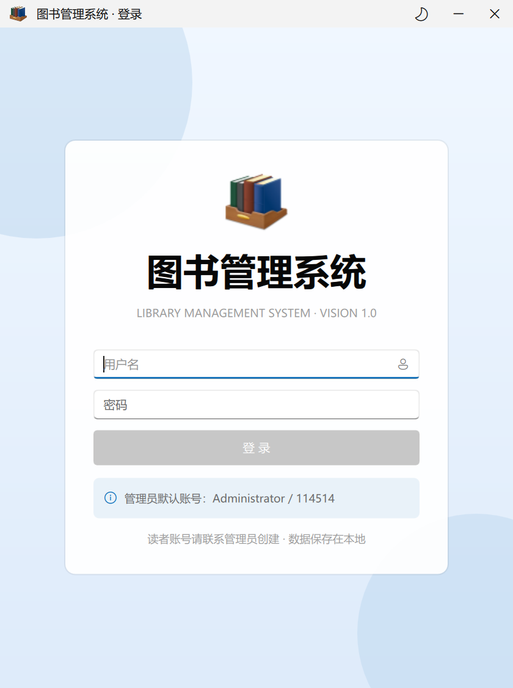
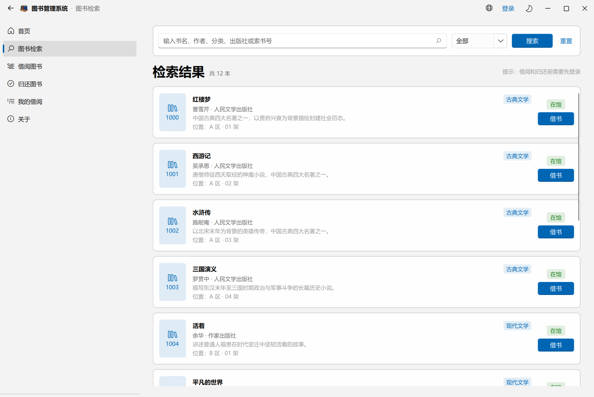
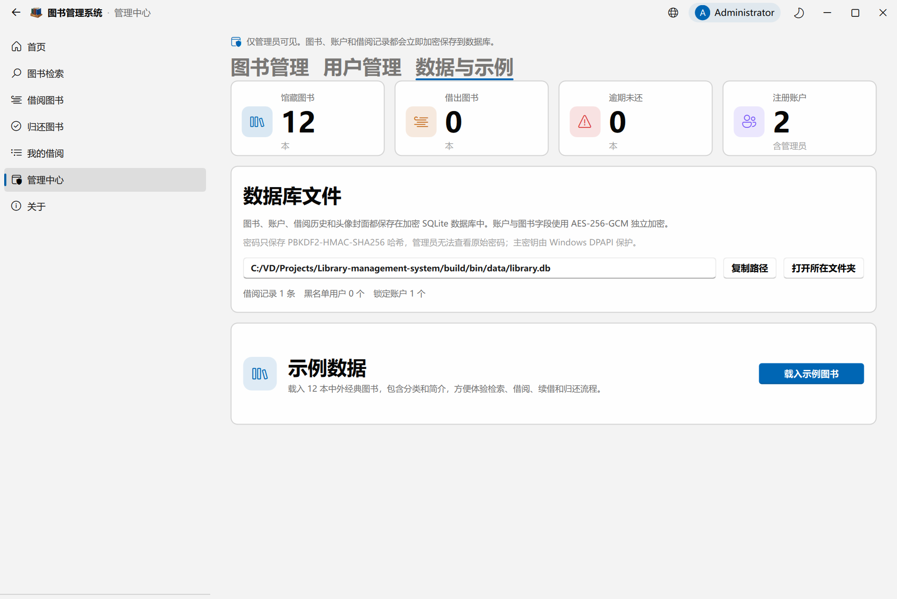
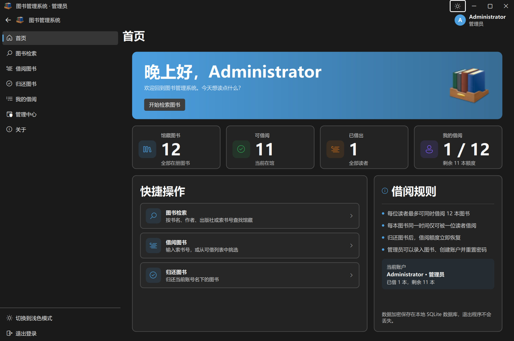

# 图书管理系统 · Qt QML + FluentUI

> 将 Vision 1.0 的 CMD + MSVC 图书管理程序重构为 **Qt 6 QML + CMake + FluentUI** 桌面应用，并继续向 Windows / macOS / Linux 跨平台演进。

[](https://www.qt.io/)
[](https://cmake.org/)
[](https://github.com/zhuzhihang/FluentUI)

---

## 项目简介

本项目最初是基于命令行的 C++ 图书管理作业（Vision 1.0，MSVC + `.sln`）。当前版本保留图书、账户、借阅、检索、管理员能力，并将界面迁移到 Fluent Design 风格的 Qt QML 桌面程序。

- **界面**：Qt 6 QML + [FluentUI 1.7.7](https://github.com/zhuzhihang/FluentUI)，自定义标题栏、响应式导航、深色 / 浅色主题。
- **业务**：C++17 `LibraryService` 单例，向 QML 暴露账户、图书、借阅、额度、统计和管理接口。
- **存储**：Qt SQL（SQLite）；用户、图书、借阅字段逐字段 **AES-256-GCM** 加密。
- **密码**：只保存 **PBKDF2-HMAC-SHA256** 哈希，管理员不能查看原始密码，只能重置。
- **多语言**：简体中文、繁體中文、English、日本語、Deutsch、Русский、한국어。

> 原始 MSVC 工程（`.sln` / `.vcxproj` / `.rc` / `Main.cpp` / `x64` 等）与旧版 `control` 数据文件已移除。

---

## 界面预览

### 登录（仅在借阅等操作时弹出）



### 首页 · 访客模式


### 图书检索



### 管理中心 · 加密数据库



### 深色主题



---

## 功能

| 模块 | 功能 |
| --- | --- |
| 访客模式 | 启动直接进入首页，可浏览馆藏、搜索图书、查看可借状态；借阅、续借、归还和额度需要登录 |
| 登录 | 用户名 / 密码登录；管理员与读者权限区分；密码连续输错 5 次临时锁定 10 分钟；管理员也可手动锁定 |
| 标题栏 | 返回、应用图标与名称、当前页、语言、登录 / 头像、主题和窗口按钮统一在标题栏；原生命中测试已覆盖自绘按钮 |
| 账户卡片 | 登录后点击头像 / 姓名，弹出账户卡片：修改个人信息、退出登录 |
| 首页 | 馆藏 / 可借 / 借出 / 我的额度统计、快捷入口、借阅规则、黑名单提醒 |
| 图书检索 | 按全部、书名、作者、索书号、分类搜索；支持 **列表 / 宫格** 切换；封面、分类、位置、状态 |
| 图书详情 | 点击任意图书卡片打开详情，查看封面、元数据、Markdown 简介和借阅状态 |
| 借阅 | 输入索书号或列表一键借阅；默认借阅期限 **1 个月**；每人默认最多 **12 本** |
| 复本 | 同一种书可按 **复本数量** 一次录入多本；每本自动分配唯一索书号 |
| 续借 | 每本图书可续借 **1 次**，到期后 1 个月；逾期后不允许续借 |
| 归还 | 输入索书号或列表一键归还；归还后额度立即恢复 |
| 黑名单 | 逾期未还或被管理员标记未还的读者进入黑名单，归还前不能继续借阅 |
| 我的借阅 | 借阅额度进度、在借清单、借阅日期、应还日期、续借状态和黑名单状态 |
| 管理中心 · 图书 | 录入图书（可选封面、Markdown 简介、分类、复本数量）、查看馆藏、借阅历史、帮助归还、标记未还 |
| 管理中心 · 用户 | 创建读者、锁定 / 解锁、重置密码、删除账户、**编辑借阅上限**；不显示密码 |
| 管理中心 · 数据 | 数据库路径、复制路径、打开文件夹、统计、载入示例图书、迁移提示 |
| 个人资料 | 修改账号名称、显示名称、头像、密码和退出登录 |
| 多语言 | 六种语言，语言按钮即时切换；翻译键覆盖全部 QML `I18n` 文案 |
| 主题 | 标题栏深色 / 浅色切换，导航栏不再重复放主题按钮 |
| 快捷键 | `Ctrl+1` 首页、`Ctrl+2` 检索、`Ctrl+3` 借阅、`Ctrl+4` 归还、`Ctrl+5` 我的借阅、`Ctrl+6` 管理中心、`Ctrl+7` 关于、`Ctrl+L` 语言、`Ctrl+P` 个人资料 |

### 账户与借阅规则

- 初始管理员：

```text
用户名：Administrator
密码：114514
```

- 管理员首次登录自动填入默认账号，并**强制修改密码**，完成前不能使用系统。
- 密码要求：至少 8 位，同时包含大写字母、小写字母、数字和特殊符号。
- 新读者账户使用初始密码登录，**不强制**首次修改密码；管理员重置密码后仍会要求下次登录修改。
- 管理员不能借书、还书或续借；只能在管理中心查看历史、帮助归还或标记未还。
- 借阅期限默认 1 个月；每本可续借一次；逾期未还会进入黑名单。
- 管理员可以为每个读者单独设置借阅上限（1-100 本）。

---

## 数据与加密

### 存储位置

默认位置（按当前用户）：

```text
Windows: %APPDATA%\BuBaiMengJ4\LibraryManagementSystem\
macOS:   ~/Library/Application Support/BuBaiMengJ4/LibraryManagementSystem/
Linux:   ~/.local/share/BuBaiMengJ4/LibraryManagementSystem/
```

目录内包含：

```text
library.db    SQLite 数据库
library.key   加密主密钥
logs/         运行日志（开发构建）
```

如果目录不可写，程序会依次回退到可执行文件旁的 `data/`、系统临时目录。

### 加密方案

- 使用 Qt SQL / QSQLITE，单文件 SQLite。
- 每个用户、图书、借阅文本字段单独 **AES-256-GCM** 加密；封面、头像作为二进制字段加密。
- 密文格式：`0x01 | 12 字节 nonce | 16 字节认证标签 | 密文`。
- AAD 绑定 `library/user/<uuid>/<字段>`、`library/book/<索书号>/<字段>`、`library/loan/<id>/<字段>`，防止密文跨字段替换。
- 密码使用 **PBKDF2-HMAC-SHA256**（100000 次迭代、16 字节盐、32 字节哈希），不可逆。
- 图书索书号、用户 UUID、借阅 ID 作为关联键保留明文，不含个人文本内容。

### 主密钥保护

| 平台 | 当前方案 |
| --- | --- |
| Windows | **DPAPI**（当前用户范围）+ BCrypt AES-GCM |
| macOS | `library.key`，权限 0600；加密算法使用 OpenSSL EVP AES-256-GCM |
| Linux | `library.key`，权限 0600；OpenSSL EVP AES-256-GCM |
| HarmonyOS PC | 使用非 Windows 文件密钥路径；后续可接系统密钥库 |

Windows 的 DPAPI 依赖已经隔离在 `#ifdef Q_OS_WIN` 中；非 Windows 构建不再链接 `bcrypt/crypt32`，而是使用 OpenSSL。macOS Keychain / Linux Secret Service 的接入点已预留，但目前仍使用仅当前用户可读写的密钥文件作为跨平台兜底方案。

### 数据库结构（schema v3）

```sql
users(id TEXT PRIMARY KEY, username_enc BLOB, display_name_enc BLOB,
      password_hash_enc BLOB, password_salt_enc BLOB, admin_enc BLOB,
      must_change_enc BLOB, locked_enc BLOB, failed_attempts_enc BLOB,
      lock_until_enc BLOB, borrow_limit_enc BLOB, avatar_enc BLOB)

books(number INTEGER PRIMARY KEY, name_enc BLOB, author_enc BLOB,
      publisher_enc BLOB, place_enc BLOB, category_enc BLOB,
      description_enc BLOB, cover_enc BLOB)

loans(id INTEGER PRIMARY KEY, book_number INTEGER, username_enc BLOB,
      borrowed_at_enc BLOB, due_at_enc BLOB, returned_at_enc BLOB,
      renew_count_enc BLOB, manual_unreturned_enc BLOB)
```

旧 schema v1 / v2 会自动迁移；v1 原文件会保留 `.v1.bak` 备份。

### 大数据量说明

- 启动时只把图书的检索元数据（书名、作者、出版社、位置、分类、索书号）加载到内存。
- 封面和 Markdown 简介按需从数据库读取，不在启动时把全部 BLOB/长文本释放到内存。
- 保存图书时，已有图书只更新元数据列，保留尚未加载的封面 / 简介；新增图书和示例数据才写入完整字段。
- 后续可继续把元数据列表改成 SQL 分页 / 增量模型，以支持十万级以上馆藏；当前接口 `searchBooks` / `books` 仍返回元数据列表，QML 侧已使用 `ListView` 虚拟化。
- 数据按字段加密，因此关键词检索在应用层完成；海量数据下建议后续增加可搜索索引或分页查询接口。

---

## 多语言

`src/qml/translations.js` 以中文原文为键，包含 286 个文案键 × 6 种语言。新增界面文案时：

1. 在 QML 中使用 `I18n.t("中文原文")` 或 `I18n.f("模板 {0}", [值])`；
2. 在 `translations.js` 对应语言中补一条翻译；
3. 未命中的键会回退中文，避免界面空白。

---

## 构建

### 环境

- Qt **6.11.1**（CI 使用 6.8.3 LTS 验证兼容）MinGW / GCC / Clang
- CMake **3.21+**
- Windows：MinGW 13.1 或 MSVC
- macOS / Linux：OpenSSL 3 开发包
- Qt SQL SQLite 驱动

### Windows

```powershell
$env:Path = "C:\Qt\Tools\CMake_64\bin;C:\Qt\Tools\mingw1310_64\bin;C:\Qt\6.11.1\mingw_64\bin;" + $env:Path

cmake -S . -B build -G "MinGW Makefiles" `
      -DCMAKE_BUILD_TYPE=Release `
      -DCMAKE_PREFIX_PATH="C:/Qt/6.11.1/mingw_64"
cmake --build build --parallel 4
cmake --build build --target deploy
```

生成 `build/dist` 便携目录，可脱离 Qt 安装目录运行。

### macOS

```bash
brew install qt openssl@3 cmake ninja
cmake -S . -B build -G Ninja \
  -DCMAKE_BUILD_TYPE=Release \
  -DCMAKE_PREFIX_PATH="$(brew --prefix qt)" \
  -DOPENSSL_ROOT_DIR="$(brew --prefix openssl@3)"
cmake --build build
bash packaging/macos/build-dmg.sh
```

### Linux

```bash
sudo apt install cmake ninja-build libssl-dev qt6-base-dev qt6-declarative-dev
cmake -S . -B build -G Ninja -DCMAKE_BUILD_TYPE=Release
cmake --build build

# DEB / RPM
cd build && cpack -G DEB && cpack -G RPM

# AppImage
BUILD_DIR="$PWD/build" bash packaging/linux/build-appimage.sh
```

### 打包文件

```text
packaging/macos/build-dmg.sh                         macOS dmg
packaging/linux/build-appimage.sh                    AppImage
packaging/linux/*.desktop / *.metainfo.xml           Linux 桌面集成
packaging/arch/PKGBUILD                              Arch Linux
packaging/flatpak/com.bubaimengj4...yml              Flatpak
.github/workflows/build.yml                          Windows / macOS / Linux / Arch / Flatpak CI
```

GitHub Actions 会产出：Windows 便携包、macOS dmg、Linux deb/rpm/AppImage、Arch 包、Flatpak bundle。

---

## 目录结构

```text
Library-management-system/
├── CMakeLists.txt
├── library.ico
├── src/
│   ├── main.cpp
│   ├── qml.qrc
│   ├── backend/
│   │   ├── Encryption.h/.cpp          DPAPI / OpenSSL AES-256-GCM
│   │   ├── LibraryImageProvider.h/.cpp
│   │   └── LibraryService.h/.cpp
│   ├── qml/
│   │   ├── App.qml / MainWindow.qml / I18n.qml / translations.js
│   │   ├── components/                TitleBar, BookCard, BookGridCard, ...
│   │   ├── dialogs/                   Login, Profile, BookDetail, BookAdmin, ...
│   │   └── pages/                     Home, Search, Borrow, Return, MyBooks, Admin, About
│   └── resources/app.rc.in
├── FluentUI/
├── packaging/                          macOS / Linux / Arch / Flatpak
├── .github/workflows/build.yml
├── docs/
└── README.md
```

---

## 已知限制

- Windows 已完整构建验证；macOS / Linux 的 CMake、OpenSSL 分支和 CI 已加入，但当前环境无法在本机执行对应平台的运行验证。
- 非 Windows 的密钥保护目前是 0600 文件，不等同于 DPAPI / Keychain 的强度；后续可接 macOS Keychain 和 Linux Secret Service。
- 元数据仍会全部加载到内存；封面和简介已延迟加载。十万级馆藏还需要 SQL 分页 / 可搜索索引。
- 管理员不能查看密码，只能重置；这是有意限制。
- 借阅上限默认 12，可按用户调整；管理员自身不参与借阅。

---

## 反馈与致谢

- 作者：**BuBaiMengJ4**、**xiaoyu1145**
- 仓库：[github.com/BuBaiMengJ4/Library-management-system](https://github.com/BuBaiMengJ4/Library-management-system)
- 反馈：[Microsoft Forms](https://forms.office.com/Pages/ResponsePage.aspx?id=DQSIkWdsW0yxEjajBLZtrQAAAAAAAAAAAAN__jFEEqlUMVhLU0RFSE0yOUxLUlRMSDAzUDRQQUJTMS4u)

感谢 FluentUI 作者 **zhuzhihang** 开源这套 Qt Fluent Design 组件库。
